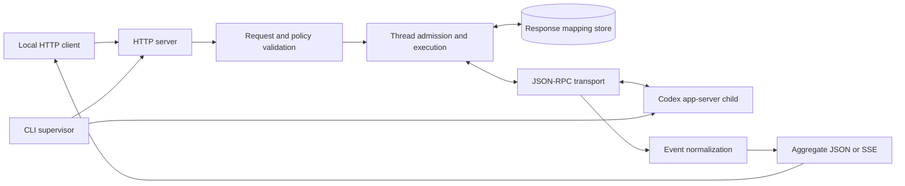

# Proxy architecture

This page is for contributors changing the proxy's runtime behavior. The [README](../../README.md) defines the public Chat Completions contract; [continuation](continuation.md) explains response IDs, tool results, and thread reuse in detail.

## Request and process flow

| Boundary                 | Owner               | Responsibility                                                                                                                                        |
| ------------------------ | ------------------- | ----------------------------------------------------------------------------------------------------------------------------------------------------- |
| Process lifecycle        | `src/cli/`          | Start the loopback listener, authenticate and supervise one private app-server transport, gate readiness, and clean up on shutdown.                   |
| Configuration and policy | `src/core/`         | Parse CLI settings, validate the loopback address and canonical root, resolve effective request policy, and write structured logs.                    |
| App-server integration   | `src/app-server/`   | Spawn the pinned Codex executable without a shell, correlate JSON-RPC messages, manage authentication and the model catalog, and read the model list. |
| HTTP contract            | `src/http/`         | Route requests, validate Chat Completions input, execute turns, normalize app-server events, and serialize JSON, SSE, and errors.                     |
| Continuation state       | `src/continuation/` | Persist response-to-thread mappings, pending client tool calls, usage boundaries, and thread leases.                                                  |

The shared completion seam in `src/sessions/completion.ts` validates request policy
and starts a Codex turn for both Chat Completions output and the management price
lookup. The latter consumes bounded final text directly and does not call the
proxy's own HTTP endpoint. HTTP serialization remains in `src/http/chat.ts`.
The HTTP listener opens before app-server authentication completes. `/health` reports that the proxy process is listening; `/ready` and model or chat requests require an authenticated, initialized app-server transport. If the child exits, the supervisor withdraws readiness and makes bounded restart attempts. It installs a replacement transport only after startup succeeds.

The JSON-RPC transport frames app-server output from byte chunks, correlates
request IDs, and settles pending calls on cancellation or stream closure.
Offline transport tests cover framing and lifecycle behavior.

## Management module

The optional `src/admin/` module owns SQLite accounting, recoverable encrypted client
keys and a separate browser-authenticated loopback listener. The CLI owns its lifecycle.
HTTP admission resolves a key identity; normalized model/usage metadata is observed
without intercepting or reparsing response bodies. One terminal record is persisted per
request ID. Browser management auth is never accepted as model API authorization.
See [management](../en/admin.md) for security, retention and authentication reuse details.

The in-memory `InteractionBroker` routes supported human questions and MCP form/URL callbacks to clients that opt into `x_codex.interaction_id`. Execution binds before `turn/start`; observed child threads inherit the original HTTP owner. Poll and reply endpoints require both the client-generated channel UUID and the original API credential fingerprint. Opaque reply ids are consumed once on the original transport; cancellation, completion and transport replacement remove pending callbacks. Interaction requests bypass the completion concurrency cap to prevent deadlock while a completion waits. Unsupported callbacks and requests without opt-in retain fail-closed behavior. The console has no interaction endpoints or UI. See [client interactions](../en/client-api.md#client-interactions).

## Startup ownership

The proxy uses the exact `@openai/codex` package pin by default and rejects an explicit executable override with a different reported version. It runs app-server in a proxy-owned Codex home, separate from the ordinary Codex CLI home. Default reuse mode synchronizes a strictly newer local `auth.json` unless `--sync-auth never` is set, without launching login/logout or writing back to the source. Only explicit independent mode starts login. The proxy never stores credentials in its continuation records.

Each new proxy process makes one bounded, catalog-only refresh attempt in a temporary Codex home. A valid refreshed cache replaces the selected home's cache; a failed refresh retains the previous cache. The temporary Responses Lite catalog override is built separately from Codex's refreshable cache and must be loaded by the serving child before readiness. Because catalog selection is a startup setting, installing or rebuilding the override can require a private child restart. App-server recovery within the same proxy process does not repeat the catalog refresh. See [upstream compatibility](codex-app-server.md#pinned-compatibility-note) for the pinned protocol context.

## HTTP translation

The public routes are `/health`, `/ready`, `GET /v1/models`, `GET /v1/models/{id}`, and `POST /v1/chat/completions`. The model routes read the active app-server catalog without starting a Codex thread or turn. A chat request is validated and assigned an effective policy before any turn starts. Execution chooses a fresh thread or an admitted continuation, then uses the same app-server event stream for aggregate JSON and SSE output. The event normalizer exposes only supported activity; unknown notifications remain diagnostic. Token usage appears only when app-server provides attributable counts.

For streaming, setup and the first event are processed before SSE headers are committed so early failures retain their HTTP error status. After headers are sent, failures are emitted inside the stream. Output writes honor backpressure; request cancellation and deadlines release the active turn and its transport work. [Continuation](continuation.md) describes how client-defined tool batches end a turn and resume through later HTTP requests.

All Codex-owned lifecycle events are response-level `x_codex.activity`, separate from standard client-executable `tool_calls`. The classification follows execution ownership rather than model, client, or tool name, so future app-server activity cannot accidentally suspend a Chat Completions client. The pinned app-server may report a child start as `subAgentActivity` rather than `spawnAgent`; the normalizer preserves the recognized activity kind and child thread ID in arguments and result content, while omitting agent paths.

## Policy boundary

The listener binds only to a validated loopback address and rejects non-loopback `Host` values and requests carrying `Origin`. A request's `x_codex` controls are constrained by the configured canonical root and app-server managed requirements. The proxy rejects a requested policy it cannot apply faithfully; it never relaxes a stricter requirement. The default `danger-full-access` sandbox enables built-in filesystem and command network access with the child process's OS permissions; hosted Web search defaults to `live` and approval policy prefers `never`. These defaults apply even when compatibility clients supply their own tools. Explicit narrower request settings and managed requirements still apply; a disallowed default is rejected. Explicit `disabled` removes execution environments. Child-agent spawning defaults on and can be disabled process-wide with `--subagents false`. The configured root bounds request `cwd`, not full-access filesystem operations.

Inline user audio maps to app-server `UserInput.audio` data URLs. App-server
rejects raw `input_file` history and has no file `UserInput` variant, so the
proxy converts inline files before policy resolution and thread creation. It
extracts each page's text and renders the complete page as a PNG image,
or parses CSV, XLSX, and UTF-8 text into bounded text parts, replacing the file
part in place. Non-PDF file parts are an `x_codex` Chat Completions extension.
History replay and the final turn use those
same ordered inputs. Conversion is bounded by PDF size, page count, pixels,
rendered image bytes, and extracted text bytes; invalid or oversized PDFs fail
before model work. File IDs and local paths are never resolved by the proxy.

On native Windows, the proxy reads effective configuration for the request's canonical working directory before starting or resuming a thread. It supplies `windows.sandbox = "unelevated"` only when neither user/project configuration nor managed requirements select a backend. A failed or malformed `config/read` fails the request before execution; the default is a per-thread override, never a persisted or process-wide rewrite.

The [security model](security.md) covers local access, persisted data, and sensitive plaintext logs. Contributor commands and offline versus live verification are in the [repository guide](development.md).

## Continuation instruction identity

Response records optionally carry `instructionsHash`, the canonical hash of joined system base instructions. Existing schema-0 records remain readable. Supplied system instructions must match this identity for native reuse; a mismatch or unknown legacy identity selects fresh execution with `continuation_instructions_mismatch`. Omitted system messages inherit the recorded identity. No instruction plaintext is added to the store or fallback diagnostics. Non-handoff upstream interruptions terminate with `app_server_interrupted` and do not create ready mappings.
